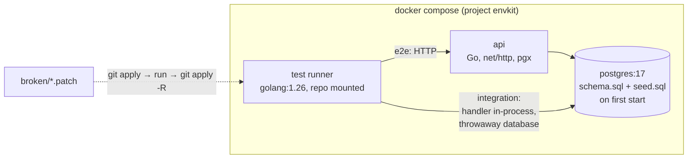

# env-kit

An orders API in Go on PostgreSQL, packaged so that `make up && make test`
works on any machine with Docker, and a test suite that is itself tested:
[`broken/`](broken/) holds three realistic regressions, and CI proves on
every push that each one makes the named tests fail.

The point is not the API (it is deliberately small) but the two questions a
test suite has to answer: *does it run the same everywhere*, and *would it
notice if the code broke*.

## Quick start

Needs Docker with Compose v2 and `make`. No Go toolchain on the host: tests
run in a `golang` container against the compose Postgres.

```bash
make up            # build the API, start Postgres with schema + seed, wait until healthy
make test          # unit + integration + end-to-end, race detector
make test-broken   # apply each broken/*.patch, require its tests to fail, restore the tree
make down          # stop and delete volumes
```

`make help` lists the targets. Host ports
(default Postgres `15432`, API `15080`) are only for poking at the stack by
hand; override with `ENVKIT_PG_PORT` / `ENVKIT_API_PORT`. Tests do not use
them, they talk to `postgres:5432` and `api:8080` inside the compose network.

```bash
curl localhost:15080/products
curl -XPOST localhost:15080/orders -H 'Idempotency-Key: demo-1' \
  -d '{"customer_id":1,"items":[{"product_id":2,"qty":1}]}'
```

If the host port does not answer (seen on a colima VM whose port forwarder
had stopped publishing new ports), the same requests work from inside the
compose network, which is also all the tests need:

```bash
docker compose --profile test run --rm --no-deps test curl -s api:8080/products
```

<details><summary><code>error getting credentials</code> on pull (macOS, colima)</summary>

If `~/.docker/config.json` says `"credsStore": "desktop"` but Docker Desktop
is not installed, every pull fails with
`docker-credential-desktop: executable file not found`. Without touching the
global config, point Docker at a config of your own:

```bash
mkdir -p ~/.docker-envkit
echo "{\"auths\":{},\"cliPluginsExtraDirs\":[\"$HOME/.docker/cli-plugins\"]}" > ~/.docker-envkit/config.json
export DOCKER_CONFIG=~/.docker-envkit
export DOCKER_HOST=unix://$HOME/.colima/default/docker.sock   # the context lived in the old config
```

`cliPluginsExtraDirs` keeps `docker compose` working; `DOCKER_HOST` replaces
the `currentContext` that was in the old config.
</details>

## What is proven, and how

| claim | evidence |
|---|---|
| A clean clone comes up and passes with two commands | `git clone` into an empty directory, `make up && make test && make test-broken`: [results/clean-clone.txt](results/clean-clone.txt); CI repeats it on every push |
| The suite catches each regression in `broken/`, on the test that names the bug | `make test-broken`: 3/3 caught, raw output in [results/broken/](results/broken/); CI job `broken` |
| …every time, not by luck (bug 01 is a race, bug 02 also hits connection pool timing) | `make catch-rate N=50`: each patch caught in **50/50** runs ([results/catch-rate.txt](results/catch-rate.txt)) |
| The suite does not cry wolf | same run: the clean tree passed the full suite in **50/50** runs |
| `make test-broken` leaves the tree as it found it | CI runs `git diff --exit-code` after it; the script reverts in an `EXIT`/`INT`/`TERM` trap |
| No data races in the code under test | every test run uses `-race` |

## Numbers

All from runs on one laptop, raw output in [`results/`](results/).

| measurement | result | raw |
|---|---|---|
| tests | 15: 2 unit, 11 integration, 2 end-to-end | [test-verbose.txt](results/test-verbose.txt) |
| clean clone: `make up` (API image built, Postgres initialised with seed) | 40 s | [clean-clone.txt](results/clean-clone.txt) |
| clean clone: first `make test` (Go modules downloaded, race build from cold cache) | 52 s | same |
| clean clone: `make test-broken`, 3 variants | 11 s, 3/3 caught | same |
| warm `make test` | 5.0 s, 4.3 s, 4.3 s (3 runs) | [make-test-warm.txt](results/make-test-warm.txt) |
| catch rate, 50 runs per variant | 50/50, 50/50, 50/50 caught; clean tree 50/50 passed; 2 min 40.8 s in all | [catch-rate.txt](results/catch-rate.txt) |

**Hardware.** Apple M4 Max (16 cores, 48 GiB). Docker runs in a colima VM
with 4 vCPU and 6 GiB, shared with other projects' compose stacks: 12 to 14
containers, this project's included, were running on the VM during these
measurements (counted with `docker ps -q` at each run, see the raw files). The clean-clone runs had the
base images (`postgres:17-alpine`, `golang:1.26-bookworm`, `alpine:3.22`)
already pulled and Docker's layer cache warm. A machine without them also
pulls the images; on disk `golang:1.26-bookworm` is 1.23 GB and
`postgres:17-alpine` 415 MB ([images.txt](results/images.txt)). Pull time was
not measured.

## Architecture



```
cmd/api/            main: config from env, pgx pool, graceful shutdown
internal/orders/    order.go   domain: status machine, request validation, request hash
                    store.go   SQL: create (one tx), reserve stock, list, transitions
                    http.go    routes and error → status mapping
                    *_test.go  unit tests and the integration suite
db/                 schema.sql, seed.sql, embedded for tests
e2e/                smoke tests against the running stack
broken/             three regressions as patches + their documentation
scripts/            test-broken.sh, catch-rate.sh
```

### API

| method | path | |
|---|---|---|
| GET | `/healthz` | 200 when the database answers |
| GET | `/products` | catalogue with stock |
| POST | `/orders` | `{"customer_id":1,"items":[{"product_id":2,"qty":1}]}`; optional `Idempotency-Key` header. 201 created, 200 replay of the same key, 409 out of stock, 422 unknown customer/product or key reused with another body |
| GET | `/orders/{id}` | order with lines |
| GET | `/orders?customer_id=&limit=&after=` | keyset pagination, `next_after` is the cursor for the next page, 0 on the last |
| POST | `/orders/{id}/pay`, `/ship`, `/cancel` | `pending → paid → shipped`, cancel from `pending` or `paid` returns the stock; anything else is 409 |

## Design decisions

- **Tests run in a container, against real Postgres.** The host needs Docker
  and make, nothing else, so "works on my machine" and "works in CI" are the
  same command. Mocks of the database would not catch two of the three bugs:
  they live in how Postgres runs concurrent transactions.
- **One throwaway database per test run, one set of rows per test.**
  `TestMain` creates `envkit_test_<pid>_<ns>` from the same `schema.sql` and
  `seed.sql` that compose loads, and drops it afterwards. Each test creates its
  own customer and products, so tests run in parallel and never depend on
  order or on what the e2e tests or a developer did to the seeded database.
- **The handler runs in-process for integration tests.** A patch from
  `broken/` is picked up by recompiling the test, no image rebuild: the whole
  `make test-broken` cycle took 11 s in the clean-clone run. The e2e package covers the
  built container separately.
- **Broken variants are patches, not build tags or flags.** A patch is
  exactly the diff a reviewer would see; nothing in the main code knows the
  bugs exist. Each patch says which tests must fail (`Expect-Fail:`), so the
  check is "the right test failed", not merely "something went red".
- **Measure the catch rate.** A test for a race that fails once might pass
  the next run. `make catch-rate` runs each variant N times and reports how
  often it was caught, and the clean tree N times for the flake rate.
- **Stock check and decrement are one statement**
  (`UPDATE … SET stock = stock - $q WHERE … AND stock >= $q`), not a
  `SELECT … FOR UPDATE` followed by an update: one round trip, and no window
  to forget the lock in. Order lines are sorted by product id first so two
  multi-line orders lock rows in the same order and cannot deadlock.
- **Idempotency in the database.** `idempotency_key` is `UNIQUE` and the
  order row is inserted first with `ON CONFLICT DO NOTHING`: a concurrent
  retry waits on the index and then returns the first order. The stored
  request hash rejects a reused key with a different body.
- **Keyset pagination** (`id > after`), so pages stay stable while orders are
  being inserted, which `OFFSET` does not.
- **Money in integer cents**, never floats.

## Limitations

- No authentication, no payments: `pay` only moves the status.
- Idempotency keys are global and kept forever; a real service would scope
  them per client and expire them.
- The seed is loaded by Postgres' init scripts, i.e. only into an empty
  volume. `make reset` gets back to seed data. There are no migrations for a
  schema change on existing data.
- Three bugs are a sample, not a mutation-testing score. A mutation tester
  (not run here) would measure the suite against many more variants.

## Reproducing the numbers

```bash
make clean-clone        # results/clean-clone.txt: clone HEAD, time up / test / test-broken
make catch-rate N=50    # results/catch-rate.txt
make up && make test-broken   # results/broken/*.txt
docker compose --profile test run --rm test go test -race -count=1 -v ./...   # test list
```

`make clean-clone` takes down this checkout's stack first: the clone uses the
same compose project name.

## Third-party code

| | license |
|---|---|
| [jackc/pgx](https://github.com/jackc/pgx) v5 and its deps puddle, pgpassfile, pgservicefile | MIT |
| golang.org/x/text, golang.org/x/sync (indirect, via pgx) | BSD-3-Clause |
| Docker images `postgres:17-alpine`, `golang:1.26-bookworm`, `alpine:3.22` | PostgreSQL License, BSD-3-Clause, MIT (base layers carry their own package licenses) |

## License

MIT, see [LICENSE](LICENSE).
